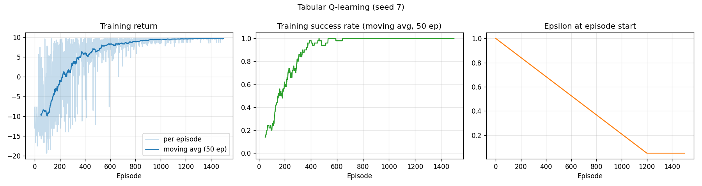
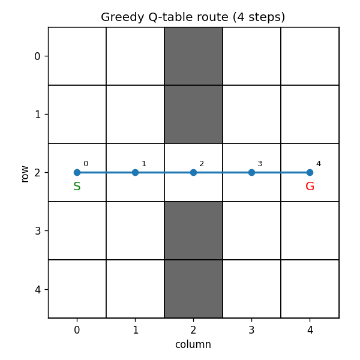
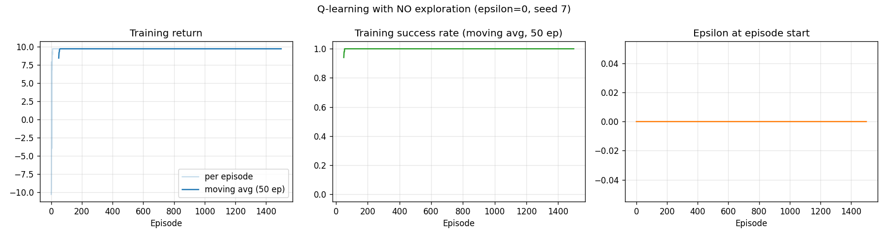
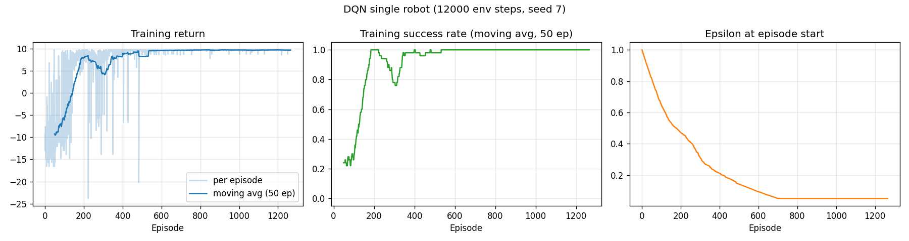
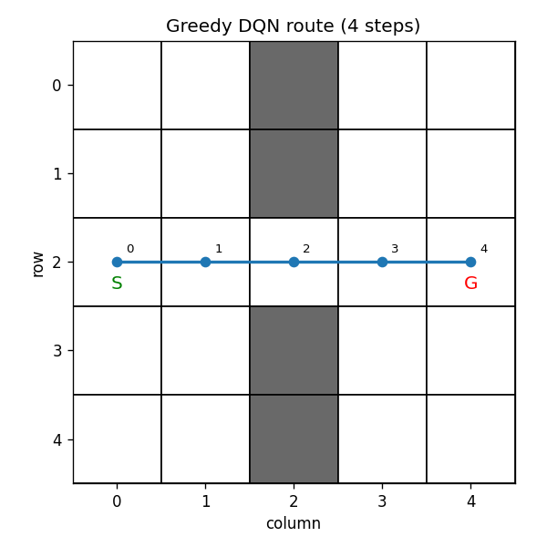
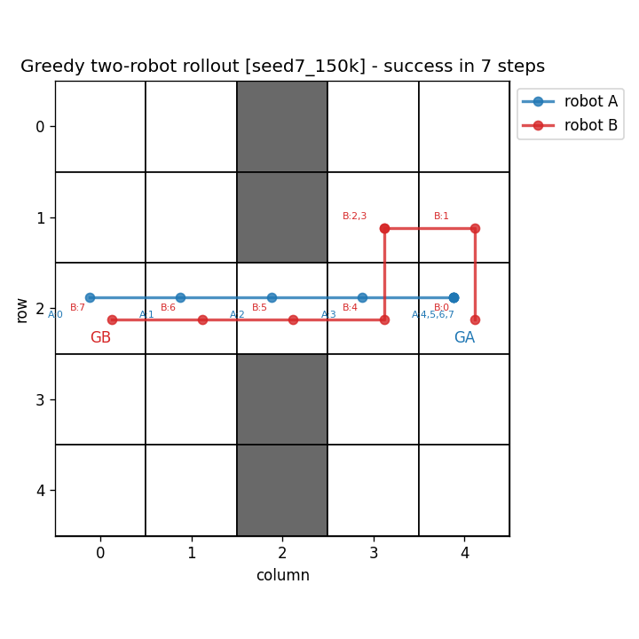
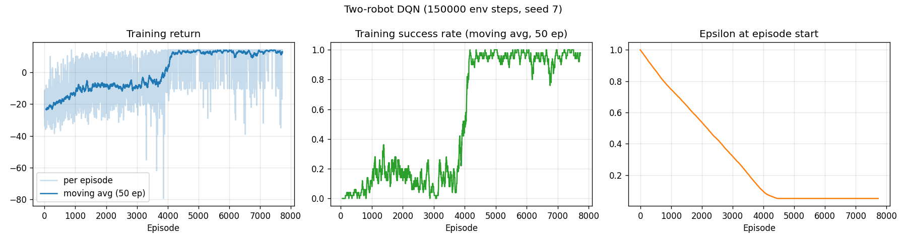

# Laboratory Exercise: Reinforcement Learning and Deep RL

**Course:** Artificial Intelligence (CS F407)
**Problem statement:** [RL_lab_2026.pdf](RL_lab_2026.pdf)

## Layout

| File | What it contains |
|---|---|
| [src/warehouse_env.py](src/warehouse_env.py) | Single-robot and two-robot warehouse environments (fixed map, rewards, termination and truncation) |
| [src/qlearning.py](src/qlearning.py) | Part I: tabular Q-learning, greedy evaluation, random baseline, no-exploration study |
| [src/dqn.py](src/dqn.py) | Part II: Q-network, replay buffer, DQN loss, generic DQN trainer, greedy evaluation |
| [src/two_robot_dqn.py](src/two_robot_dqn.py) | Part III: central two-robot DQN controller, joint-step tables and plots |
| [src/tests.py](src/tests.py) | Pre-training tests for Tasks 4, 6 and 7 (environment, TD update, DQN loss, collisions) |
| [src/plotting.py](src/plotting.py) | Training curves and grid trajectory plots |
| [src/replot_two_robot.py](src/replot_two_robot.py) | Re-evaluates saved two-robot models without training |
| [src/prompts.md](src/prompts.md) | The LLM prompts used, and corrections |
| [results/](results/) | Logs (`*_results.txt`, `tests_output.txt`), plots (`*.png`), saved models, JSON summaries |

## Reproducing

```bash
python -m pip install numpy==2.1.3 matplotlib==3.10.7 torch==2.15.0 --index-url https://download.pytorch.org/whl/cpu --extra-index-url https://pypi.org/simple
cd src
python tests.py                  # all checks must print PASS (exit code 0)
python qlearning.py              # Part I   (~5 s)
python dqn.py                    # Part II  (~20 s)
python two_robot_dqn.py --seed 7 --steps 60000     # Part III, run required by the lab
python two_robot_dqn.py --seed 11 --steps 60000    # extra seed
python two_robot_dqn.py --seed 7 --steps 150000    # larger budget
```

Versions: Python 3.11.9, NumPy 2.1.3, Matplotlib 3.10.7, PyTorch 2.15.0+cpu, run on a CPU under Windows 11.
Every run sets its seed explicitly (Python `random`, NumPy `default_rng` and `torch.manual_seed`).

> **Windows note:** with Windows long paths turned off, `pip install torch` into the Microsoft Store
> Python's user site-packages installs a truncated package (`No module named 'torch.torch_version'`).
> Installing into a venv at a short path (for example `%USERPROFILE%\.venvs\rl-lab`) fixes this.

---

# Part I: Q-learning agent

## Task 1: The MDP

| Component | Specification |
|---|---|
| **State** | The robot's cell `(r, c)` with `r, c ∈ {0..4}`, excluding the obstacle cells {(0,2),(1,2),(3,2),(4,2)}. That leaves 21 reachable states. |
| **Actions** | `0 Up, 1 Down, 2 Left, 3 Right, 4 Wait`. Each takes one time step. |
| **Transition rule** | Deterministic: `(r, c) + δ(a)`. If the target cell is off the grid or an obstacle, the robot stays where it is (an *invalid* move). Wait always stays. |
| **Reward** | Mutually exclusive: **+10** if the action reaches the goal, **−1** if it is an obstacle or boundary move, **−0.1** for any other valid action (including Wait). |
| **Initial state** | `S = (2, 0)` |
| **Terminal outcome** | Reaching `G = (2, 4)` ends the task (true termination). Separately, data collection stops an unfinished rollout after **40 steps**. That is *truncation*, not a terminal state of the task. γ = 0.95. |

**(a) What is needed to specify the state?** Only the robot's current position. Everything else that affects the next state or reward (the map, the goal, the reward rules) is fixed for the whole experiment.

**(b) Why is the position enough?** With a fixed map and goal, the next position and the reward depend only on the current position and the action (the Markov property). Knowing how the robot got to a cell tells you nothing more about the future. The step counter is not part of the state, because the 40-step cutoff is a data-collection limit and not a deadline in the task.

**(c) Is the transition rule deterministic?** Yes. Each (state, action) pair leads to exactly one next state and one reward. The only randomness in this lab comes from the agent's exploration and tie-breaking.

**(d) The shortest valid route from S to G:** `(2,0) → (2,1) → (2,2) → (2,3) → (2,4)`, which is **4 moves (Right ×4)**. Column 2 is blocked everywhere except the doorway (2,2), so every route must pass through it, and 4 is the Manhattan distance. Its return is −0.1·3 + 10 = 9.7 (undiscounted).

**(e) Is finding the route by search the same as learning action values?** No. Search (for example BFS or A*) uses a *known model* (the map and transition rule), plans offline and returns a path. Q-learning gets no model and no path. It estimates Q(s, a), the expected discounted return, from sampled experience (s, a, r, s′) by trial and error, and the route only *emerges* from acting greedily on those estimates. The learner also learns values for every state it visits, not just the ones on one path, and needs many episodes to do so.

## Task 2: Agent design (written before prompting)

1. **Representation:** the map is a fixed set of obstacle cells inside a 5×5 boundary. The robot position is a tuple `(r, c)`, and `cell_index(r, c) = 5r + c`.
2. **`reset(start=None)`** puts the robot on the start cell (default (2,0)) and zeroes the step counter. **`step(a)`** computes the proposed cell, keeps the old cell if the move is invalid, increments the step counter, and returns `(next_state, reward, terminated, truncated, info)`. Here `terminated = (next == G)`, `truncated = (not terminated) and steps ≥ 40`, and `info["invalid"]` is a bool. There is also a test mode, `set_position(pos, steps_taken)`, which places the robot directly without training.
3. **Q-table:** a NumPy array of shape 25×5 indexed by `Q[5r + c, a]`, initialised to zero. The rows for obstacle cells are never used.
4. **Epsilon-greedy:** with probability ε, pick uniformly from all 5 actions. Otherwise pick uniformly among the actions that tie for the highest Q-value (random tie-breaking in training). ε falls linearly from 1 to 0.05 over the first 1,200 of 1,500 episodes, then stays at 0.05.
5. **Terminal flag in the target:** `y = r` if `terminated`, otherwise `y = r + γ·max_a′ Q(s′, a′)`. **Truncation does not change the target** (the update bootstraps), and `s′` is always the state returned by `step` *before* any reset.
6. **When an episode stops:** on termination (goal) or truncation (40 steps), whichever comes first.
7. **Training vs. evaluation:** training uses ε-greedy with random tie-breaks and updates Q after every step. Evaluation uses **ε = 0**, makes **no updates**, and breaks ties with a fixed rule (`np.argmax`, lowest action code), so it is reproducible.

**What gets recorded:** per training episode, the return, success, ε, length, number of invalid moves and timeout flag. For evaluation, the greedy trajectory (positions and actions), its length, invalid moves, success and timeout.

## Task 3: LLM implementation

The prompts are in [src/prompts.md](src/prompts.md). Every prompt gave the exact map, coordinates, action codes, rewards, and the termination/truncation rule from the design above. The generated code was read before anything was trained, and the tests below were run before any training.

## Task 4: Environment and update tests

Full output: [results/tests_output.txt](results/tests_output.txt). **All checks pass.**

| Position | Action | Expected | Program |
|---|---|---|---|
| (0,0) | up | stay (0,0), −1, no termination | (0,0), −1.0, term=False ✅ |
| (1,1) | right | stay (1,1), −1, no termination | (1,1), −1.0, term=False ✅ |
| (2,1) | right | move to (2,2), −0.1 | (2,2), −0.1 ✅ |
| (2,1) | wait | stay (2,1), −0.1 | (2,1), −0.1 ✅ |
| (2,3) | right | reach (2,4), +10, terminate | (2,4), +10.0, term=True ✅ |

**Truncation:** 40 Waits from (2,0) give `truncated=False` after step 39, then `truncated=True, terminated=False` after step 40. The rollout then stops, and another `step` raises an error. Reaching the goal *on* step 40 counts as termination, not truncation.

**Synthetic Q-learning update** with Q(s,a) = 0.4, max Q(s′,·) = 2, α = 0.2, γ = 0.95, computed by hand:

| Case | Target y | Updated Q(s,a) | Program |
|---|---|---|---|
| Non-terminal, r = 1 | 1 + 0.95·2 = **2.9** | 0.4 + 0.2·(2.9 − 0.4) = **0.9** | 2.9, 0.9 ✅ |
| Truly terminal, r = 5 | **5** (next value ignored) | 0.4 + 0.2·(5 − 0.4) = **1.32** | 5.0, 1.32 ✅ |
| Non-terminal, r = 1, *truncated* | **2.9** (bootstraps) | **0.9** | 2.9, 0.9 ✅ |

**Only the true terminal case ignores the next-state value.** Truncation is an artificial cut in data collection, and the robot could have kept going from s′, so the value of s′ still belongs in the target. Leaving it out would teach the agent that wandering for 40 steps ends the task. An integration test also passes the real environment's flags at step 40 into `q_update` and confirms the target is −0.1 + 0.95·2.

**Where the concepts are in the code:**

| Concept | Function / line |
|---|---|
| State and action representation | `cell_index` [warehouse_env.py:61](src/warehouse_env.py:61), `ACTION_NAMES`/`DELTAS` [warehouse_env.py:36](src/warehouse_env.py:36), `propose_move` [warehouse_env.py:76](src/warehouse_env.py:76), Q-table `np.zeros((25, 5))` in `train_q_learning` [qlearning.py:68](src/qlearning.py:68) |
| Reward and termination | `WarehouseEnv.step` [warehouse_env.py:133](src/warehouse_env.py:133): termination at line 140, truncation at line 148 |
| Epsilon-greedy action choice | `epsilon_greedy` [qlearning.py:38](src/qlearning.py:38), schedule `linear_epsilon` [qlearning.py:30](src/qlearning.py:30), evaluation `greedy_action` [qlearning.py:47](src/qlearning.py:47) |
| TD target and Q-table update | `td_target` [qlearning.py:53](src/qlearning.py:53), `q_update` [qlearning.py:59](src/qlearning.py:59) (the update itself is at line 63) |
| Training and greedy evaluation | `train_q_learning` [qlearning.py:68](src/qlearning.py:68), `greedy_rollout` [qlearning.py:100](src/qlearning.py:100) |

## Task 5: Training, evaluation and exploration

Settings: α = 0.2, γ = 0.95, Q₀ = 0, seed 7, 1,500 episodes, ε 1 → 0.05 linearly over 1,200 episodes, 40-step cutoff.
Moving-average window: **50 episodes**. Full log: [results/qlearning_results.txt](results/qlearning_results.txt).



* First success at episode 29. Success rate over the last 100 training episodes = 1.00, mean return over the last 100 = 9.65. Overall, 166 of 1,500 episodes timed out, all of them early while ε was high.

**Greedy evaluation** (ε = 0, no updates, fixed tie-break) from (2,0):

```
SUCCESS: steps=4, invalid=0, return=9.70
  positions: (2, 0) -> (2, 1) -> (2, 2) -> (2, 3) -> (2, 4)
  actions  : Right, Right, Right, Right
```



The learned route has **4 steps, the same as the shortest route from Task 1**. The learned values match the exact discounted returns of the optimal policy. For example, Q((2,3),Right) = 10.00, Q((2,2),Right) = −0.1 + 0.95·10 = 9.40, and Q((2,0),Right) = 8.29.

**Comparison with a uniformly random policy** (100 episodes, same map, start, rewards and 40-step cutoff, seed 7):

| Measure | Random policy (100 runs) | Greedy Q-policy (single deterministic run) |
|---|---|---|
| Goal reached | 18 / 100 (18 %) | Yes |
| Steps to goal, if successful | 26.9 (mean over the 18 successes) | 4 |
| Timeouts | 82 / 100 (82 %) | 0 |
| Invalid moves | 9.86 per run (986 total) | 0 |

**(a) Why might the training curve stay noisy after a good route is learned?** The curve plots the *behaviour* policy, which is still exploring. Even at ε = 0.05, about one action in 20 is random. A random step can bump a wall (−1), add extra steps, or occasionally cause a timeout, so some episodes score below 9.7 while the greedy policy is already optimal. Before ε reaches its floor, exploration is much heavier. Random tie-breaking adds variation too, and so does a Q-table that is still being updated, because changing values can briefly switch the greedy action in rarely visited states.

**(b) Does a high training return imply a good greedy policy?** Not necessarily. Training return measures the exploratory policy on the states it happened to visit. It can be high by luck (for example, random actions that happened to lead to the goal), or it can be an average that hides a greedy policy that loops in a state exploration never fixed. Ties in Q can also be broken differently in training (randomly) than in evaluation (fixed). The greedy policy has to be evaluated separately, with ε = 0 and no updates. Here both are good, but only the separate evaluation shows that.

**(c) What is the difference between α and ε?** α (learning rate) controls *how much* one TD error changes the estimate: `Q ← Q + α(y − Q)`. It belongs to the **learning/update** step. ε (exploration probability) controls *which action is taken* while collecting data. It belongs to the **behaviour/action-selection** step. α affects how fast and how stably the values converge. ε affects which state–action pairs get any data at all.

### Optional: no exploration (ε = 0 throughout)

All other settings fixed. Ties are still broken randomly during training.

| Seed | No exploration: first success | No exploration: greedy result | ε-greedy: greedy result |
|---|---|---|---|
| 7 | episode 2 | success, 4 steps | success, 4 steps |
| 11 | episode 2 | success, 4 steps | success, 4 steps |
| 23 | episode 0 | success, 4 steps | success, 4 steps |



As the handout warns, no exploration does **not** fail here. Every step reward is negative (−0.1 or −1), so with Q₀ = 0 any action already tried looks *worse* than an untried one (still 0). Together with random tie-breaking, this makes the agent try every action in a state before repeating one: the zero initialisation is effectively *optimistic*, so exploration still happens. The task is also small and deterministic. With a positive per-step reward, or Q₀ initialised high for one action, pure greedy behaviour could lock onto a poor action and never find the doorway.

---

# Part II: DQN

## Task 6

**What changes:** Q(s, ·) now comes from a network instead of a table lookup. The state is fed to it as a 25-long one-hot vector. Learning becomes mini-batch gradient descent on the mean squared TD error. A replay buffer and a target network are added, and ε is scheduled per environment step instead of per episode.
**What stays the same:** the environment and its step function, rewards, start, goal, γ = 0.95, the 40-step truncation, the terminated/truncated distinction (bootstrap on truncation only), ε-greedy training, and greedy evaluation with ε = 0 and no updates.

Network: `25 → Linear → 64 ReLU → Linear → 64 ReLU → Linear → 5`. The outputs are raw Q-values, with no softmax.
Hyper-parameters: replay buffer of 20,000, batch 64, 500 warm-up steps, 1 Adam update (lr 1e-3) every 4 environment steps, target copied every 250 updates, MSE loss, 12,000 environment steps, ε 1 → 0.05 over the first 9,600 steps, seed 7.

**Loss tests before training** (γ = 0.95, all pass, see [results/tests_output.txt](results/tests_output.txt)): a stub online network returns Q(s,·) = [0.5, 1.0, 1.5, 2.0, 2.5] and a stub target network returns [0, 2, 1, −1, 0.5], so max = 2.

| Row | Recorded a | r | d | Target y | Q_θ(s, a) |
|---|---|---|---|---|---|
| Non-terminal | 3 | 1 | 0 | 1 + 0.95·2 = **2.9** ✅ | 2.0 |
| Terminal | 0 | 5 | 1 | **5** (next value ignored) ✅ | 0.5 |
| Truncated | 1 | 1 | 0 (truncation stored as d = 0) | **2.9** ✅ | 1.0 |

* Loss = ((2 − 2.9)² + (0.5 − 5)² + (1 − 2.9)²)/3 = **8.2233** ✅
* Q_θ(s, a) is taken for the *recorded* action. The gradient lands only on actions 3, 0 and 1 (−0.6, −3.0, −1.267), and actions 2 and 4 get 0 ✅.
* `y.requires_grad == False`, and after `backward()` every target-network parameter still has `grad is None` ✅. The same check passes with the real 25-64-64-5 networks.

**Where the recorded action is selected:** in `dqn_loss`, [dqn.py:107](src/dqn.py:107), with `q_sa = online(s).gather(1, a.unsqueeze(1))`. The network outputs all 5 Q-values, and `gather` picks the column of the action actually stored in the replay buffer. The `max` over actions is used only inside the target, on the target network.

| DQN component | Location |
|---|---|
| Replay buffer | `ReplayBuffer` [dqn.py:69](src/dqn.py:69). Each transition is pushed at [dqn.py:169](src/dqn.py:169) (truncation stored as d = 0) |
| Batch sampling | `ReplayBuffer.sample` (uniform random indices), called at [dqn.py:178](src/dqn.py:178) |
| TD target | `dqn_loss` [dqn.py:108-110](src/dqn.py:108): `torch.no_grad()`, `y = r + γ(1 − d)·max Q_target(s′)` |
| Optimizer step | [dqn.py:180-182](src/dqn.py:180): `zero_grad`, `backward`, `step`, once every 4 environment steps after 500 warm-up steps |
| Target-network sync | initialised at [dqn.py:148](src/dqn.py:148), copied every 250 updates at [dqn.py:188](src/dqn.py:188) |

**Results** (full log: [results/dqn_results.txt](results/dqn_results.txt)): 1,266 episodes, 2,876 optimizer updates and 11 target syncs. The first training success came at episode 10, and the success rate over the last 100 episodes was 1.00.



```
Greedy DQN from (2,0): SUCCESS: steps=4, invalid=0, return=9.70
  positions: (2, 0) -> (2, 1) -> (2, 2) -> (2, 3) -> (2, 4)
Q_theta((2,0), .) = Up:7.33, Down:6.97, Left:6.68, Right:8.30, Wait:7.67
Q-table  ((2,0), .) = Up:7.29, Down:7.29, Left:6.87, Right:8.29, Wait:7.77
```



The DQN greedy route is **identical to the Q-table route** (4 × Right), and its value estimates at the start cell are within about 0.3 of the converged table. As the handout notes, the two runs had different budgets (1,500 episodes vs. 12,000 environment steps), so this does not show which method is more sample-efficient. The point is that the network learned an equivalent action-value function.

---

# Part III: Two robots

## Task 7: Controller design (before prompting)

**(a) Why is observing only A's position insufficient?** The reward and transitions depend on *both* robots. Whether A's "Right" is safe or a −10 collision depends on where B is, and B blocks the only doorway at different times. With only pA, two situations that need different actions would look identical, so the observation would not be Markov. One central controller choosing both moves therefore needs the whole joint state.

**(b) Representation:** the state is the ordered pair `(pA, pB)`. The network input is `concat(one_hot(pA), one_hot(pB))`, a vector of length **50** ([warehouse_env.py `two_robot_one_hot`](src/warehouse_env.py:169)).

**(c) Number of joint actions:** 5 × 5 = **25**, encoded as `j = 5·a_A + a_B` and decoded with `divmod(j, 5)`. The network has 50 inputs and 25 linear outputs.

**(d) One collision-free route** (B crosses first while A steps aside; 7 joint steps):

| t | A | B | Note |
|---|---|---|---|
| 0 | (2,0) | (2,4) | starts |
| 1 | (2,1) | (2,3) | both head to the door |
| 2 | (1,1) | (2,2) | **A moves aside** up into the left room; B enters the door |
| 3 | (1,1) | (2,1) | A waits; B passes underneath |
| 4 | (2,1) | (2,0) ✔ | A follows B into the cell it vacates (allowed); B home, +5 |
| 5 | (2,2) | (2,0) | A in the door |
| 6 | (2,3) | (2,0) | |
| 7 | (2,4) ✔ | (2,0) | A home: +5 + 5 bonus; terminate |

The mirror-image plan (A crosses first while B steps aside to (1,3) or (3,3)) also takes 7 steps. Seven is the minimum: both robots need the doorway, and a swap is forbidden, so one robot can enter the doorway only after the other has left the corridor next to it.

**(e) Where one robot might wait or move aside:** in the cells next to the corridor row in its own room, (1,1)/(3,1) on the left or (1,3)/(3,3) on the right. The corridor `(2,1)–(2,2)–(2,3)` is one cell wide, so the robots cannot pass each other in it. A robot standing in row 2 would either block the other or force a head-on/swap collision.

**Simultaneous-movement rules as implemented** (`TwoRobotWarehouseEnv.step`, [warehouse_env.py:219](src/warehouse_env.py:219)): both proposals come from the same old state. An obstacle or boundary move becomes a stay and adds 1 to b. A robot already at its goal stays and adds nothing to b. A collision is a same cell (`nA == nB`, which includes entering a waiting or parked robot's cell) or a swap (`nA == old_B and nB == old_A`), at [lines 236-237](src/warehouse_env.py:236). On a collision, the old positions are kept, r = −10 and the episode terminates. Otherwise r = −0.1 − b + 5k + 5I ([line 252](src/warehouse_env.py:252)), and the episode terminates when both robots are home. Truncation happens at 40 joint steps.

**Predictions vs. environment** (all match, see [results/tests_output.txt](results/tests_output.txt)):

| Old A, B | A action | B action | Prediction | Environment |
|---|---|---|---|---|
| (2,1), (2,3) | right | left | Both propose the door (2,2): **same-cell collision**. Positions stay (2,1),(2,3), r = −10, terminate | ✅ |
| (2,1), (2,2) | right | left | A → (2,2), B → (2,1): **swap collision**, r = −10, terminate | ✅ |
| (2,1), (2,2) | right | right | A follows B into the door as B moves to (2,3): **allowed**, r = −0.1 | ✅ (2,2),(2,3) |
| (2,1), (2,2) | up | wait | A steps aside to (1,1) and B waits in the door: no collision, r = −0.1 | ✅ (1,1),(2,2) |

Extra checks, all passing:
* A enters waiting B's cell: collision.
* B bumps an obstacle: b = 1, r = −1.1.
* Both robots hit the boundary: b = 2, r = −2.1.
* **A robot at its goal:** A arrives (k = 1, r = 4.9). On the next steps "Left" and "Up" leave A at (2,4), with no invalid penalty and **no repeated arrival reward** (r = −0.1).
* B moving into parked A's cell is a collision.
* Both arrive in the same step: k = 2, I = 1, r = 14.9.
* The second robot arrives later: r = 9.9.
* 40-step truncation works.

## Task 7: Training and results

The DQN code from Task 6 is reused **unchanged**, except that the input is 50 and the output is 25. There is **no path planner and no action filter**: the greedy policy is evaluated on exactly the joint actions it picks. Each run's full log, including the joint-step table: `results/two_robot_results_<tag>.txt`.

| Run | Budget | Episodes / updates / target syncs | Last 200 training episodes (success / collision / timeout) | Greedy rollout from A(2,0), B(2,4) |
|---|---|---|---|---|
| **seed 7, 60k** (required run) | 60,000 steps | 1,926 / 14,876 / 59 | 0.07 / 0.10 / 0.83 | ❌ **timeout**: A home at t = 8, B never crosses |
| seed 11, 60k (another seed) | 60,000 steps | 1,942 / 14,876 / 59 | 0.02 / 0.08 / 0.90 | ❌ **timeout**: A home at t = 6, B oscillates next to its goal |
| **seed 7, 150k** (larger budget) | 150,000 steps | 7,726 / 37,376 / 149 | **0.96 / 0.03 / 0.01** | ✅ **success in 7 joint steps**, 0 invalid, 0 collisions |

Both 60k runs failed. I kept them, as the handout asks, and they are explained below. The larger budget succeeded.

### Successful run (seed 7, 150,000 steps): greedy joint rollout

```
  t    A old   B old   A act  B act    A new   B new   reward
  1   (2, 0)  (2, 4)   Right     Up   (2, 1)  (1, 4)    -0.10
  2   (2, 1)  (1, 4)   Right   Left   (2, 2)  (1, 3)    -0.10
  3   (2, 2)  (1, 3)   Right   Wait   (2, 3)  (1, 3)    -0.10
  4   (2, 3)  (1, 3)   Right   Down   (2, 4)  (2, 3)     4.90
  5   (2, 4)  (2, 3)   Right   Left   (2, 4)  (2, 2)    -0.10
  6   (2, 4)  (2, 2)   Right   Left   (2, 4)  (2, 1)    -0.10
  7   (2, 4)  (2, 1)    Wait   Left   (2, 4)  (2, 0)     9.90
=> SUCCESS: joint steps=7, invalid moves=0, team return=14.30, at goal (A,B)=(True, True)
```




This is the mirror image of the hand-designed route in (d), and it has the same length: 7 joint steps, which is the minimum. At t = 4, B steps down into (2,3) at the same moment A leaves it for (2,4). That is the allowed "following" move. After t = 4, A is parked, so its requested actions ("Right", "Wait") are ignored by the environment.

**(a) Which robot entered the passage first?** **Robot A.** It went straight along row 2 and was in the doorway (2,2) at t = 2.
**(b) Where did the other robot yield?** **Robot B** left its start cell (A's goal) at t = 1, going up to (1,4). It moved to **(1,3)** at t = 2 and **waited there** at t = 3, off the corridor row and next to (2,3). At t = 4 it dropped into (2,3) right behind A, then went through the door to (2,0).
**(c) Is avoiding collisions sufficient to count as success?** **No.** Both failed 60k policies have **zero collisions** in their greedy rollouts and still fail, because B never reaches its goal before the 40-step cutoff. A controller that never moves B, or that oscillates forever, avoids collisions trivially. Success means *both* robots arriving (termination with I = 1) without a collision.
**(d) Joint-action output size for three robots:** 5³ = **125** outputs (and 75 one-hot inputs). In general, 5ⁿ outputs for n robots, which grows exponentially. This is why central joint-action DQN does not scale well, and why factored or decentralised controllers are used for larger teams.

### Why the 60k runs failed

In both failed runs, A learned to get home and then **B's endgame was never learned**. Looking at the saved networks' Q-values with A parked at (2,4) shows the cause:

| Run | State (A, B) | Q(A=Wait, B = Up / Down / Left / Right / Wait) | True optimal value |
|---|---|---|---|
| seed 11, 60k | (2,4), (2,1) | 11.34 / 11.15 / **9.27** / 11.50 / 11.77 | B·Left reaches the goal: **exactly 9.9** (terminal) |
| seed 7, 60k | (2,4), (3,3) | 8.20 / 7.86 / 7.02 / 8.09 / 8.11, max over all 25 = 8.29 | B·Up is the start of the 4-step route home (≈ 8.2) |

* **Seed 11 (overestimation):** with A parked, no return from any state can be above 9.9. Yet the network rates every non-terminal action at about 11.2–11.8, and only "Left", whose target is anchored to the true terminal reward, at 9.27. Those inflated values come from bootstrapping through `max` over 25 noisy outputs (maximisation bias). The greedy policy avoids the one correct action and oscillates between (2,1) and (1,1) until it times out.
* **Seed 7 (noise swamps the signal):** once A is parked, its action has no effect, so each B action appears 5 times among the 25 joint actions with slightly different, noisy estimates. The true differences between B's options are about 0.1–0.4, which is the same size as that noise. The `argmax` over 25 outputs therefore picks noise, and B oscillates between (3,3) and (3,4).
* **Data:** under heavy exploration, episodes where A gets home *and then* B gets through the door are rare. Over the whole run only 243 of 1,926 episodes succeeded, so those states are poorly represented in the buffer. In the 60k runs ε reached its floor at step 48k, which left only about 3,000 updates of near-greedy data. In the 150k run, success jumped from about 0.2 to 0.96 between steps 109k and 118k (ε ≈ 0.14 → 0.06). Near-greedy behaviour got A home reliably, which filled the buffer with B-endgame transitions, and the inflated values were corrected. The larger budget changes both the number of updates (37k vs. 15k) and the length of the ε schedule, so these runs cannot separate the two effects.

---

# Evaluation and Reflection

## Task 8: Comparison of the three controllers

Greedy evaluation with ε = 0 and learning switched off. Each entry is a **single deterministic rollout**. Running a deterministic greedy policy again from the same start just repeats it, so it would not add independent trials.

| Measure | Q-table, one robot | DQN, one robot | DQN, two robots |
|---|---|---|---|
| Budget and seed | 1,500 episodes, seed 7 | 12,000 env steps, seed 7 | 60,000 steps, seed 7 (required); 60,000, seed 11; **150,000, seed 7** |
| Success / collision / timeout | success | success | 60k s7: **timeout** · 60k s11: **timeout** · 150k s7: **success** (no collision in any run) |
| Steps, if successful | 4 (optimal) | 4 (optimal) | 7 joint steps (150k; optimal) |
| Invalid moves | 0 | 0 | 0 (all three runs) |
| **Additional start** | **(0,0): success, 6 steps, 0 invalid** | **(0,0): success, 6 steps, 0 invalid** | **A(0,0), B(4,4)**: 150k: **success, 9 steps, 0 invalid** · 60k s7: timeout (A home, B not; 2 invalid) · 60k s11: timeout (neither home) |

Trajectories from the additional start:

* Q-table: `(0,0)→(1,0)→(2,0)→(2,1)→(2,2)→(2,3)→(2,4)`.
* DQN: `(0,0)→(1,0)→(1,1)→(2,1)→…→(2,4)`.

Both take the minimum of 6 moves (2 down and 4 right).

The 150k two-robot policy first moves A to (2,0) and B to (2,4), which is the training start configuration, in 2 steps. It then repeats its learned 7-step plan, so it takes 9 steps in total.

**Does the policy work from these starts?** Yes for both single-robot learners, and yes for the successful two-robot controller. But that is not guaranteed by how they were trained. Training always started from the default start, and the policy is only good where it got enough data. These starts worked because early, near-random exploration visited (0,0) and the corners, so the Q-table has converged values there. The networks generalised to those states and to the paths that lead back to the familiar corridor. A start that exploration rarely reached could fail, as both 60k two-robot policies do. Each result is one deterministic rollout and does not measure a success rate.

The raw returns are **not comparable across tasks**. The single robot's maximum is 9.7 (+10 for the goal). The team task allows up to 15 in arrival bonuses and charges per joint step, so 14.3 and 9.7 measure different things.

## Reflection on the LLM's contribution

The LLM was Claude (Claude Code). It worked from the handout and the design above. The prompts are in [src/prompts.md](src/prompts.md).

**1. Which parts of the design were specified before requesting code?** All of the problem semantics:

* the state (position only), the action codes, and the transition rule for invalid moves
* the three mutually exclusive rewards
* termination vs. truncation, and bootstrapping only on truncation
* Q-table indexing (5r + c) and the ε schedule
* random tie-breaking in training vs. fixed tie-breaking in evaluation
* evaluation with ε = 0 and no updates
* the DQN architecture and every hyper-parameter
* the two-robot state, the joint-action encoding, the simultaneous-movement and collision rules, and the team reward

The LLM decided only implementation details.

**2. Did the LLM change any rewards, stopping rules or algorithm details?** No. The tests confirm that the rewards, the 40-step truncation, the terminal-only cut of the bootstrap, the collision rules and the team reward match the specification. The LLM made the following choices that the spec did not dictate, all of which I checked and kept:

* Replay batches are drawn uniformly **with replacement**.
* A robot already at its goal is never counted in b, even if its requested action points at a wall.
* Calling `step()` after an episode has ended raises an error.
* ε is logged once per episode (its value at episode start).
* The DQN's greedy tie-break is `torch.argmax`, which picks the first maximum.

**3. Which errors did the tests reveal?** None in the environment or learning code. Every check passed on the first run. That shows the *tested* rules are implemented as specified. It does not prove the program has no bugs. The problems found were:

* the PyTorch installation (Windows long paths, an environment issue)
* overlapping time labels in the two-robot plot (fixed)
* the two-robot **learning** failure at 60k

The tests rule out the environment and the loss as the cause of that failure. Looking at the Q-values traced it to overestimation and too little endgame data (see above).

**4. Did the code use a replay buffer and a target network as requested?** Yes:

* `ReplayBuffer` has capacity 20,000 and gives uniform random batches of 64. The target network is initialised from the online network and copied every 250 updates.
* The logs confirm the counts. 12,000 steps give (12,000 − 500)/4 + 1 = 2,876 updates and ⌊2,876/250⌋ = 11 syncs. 60,000 steps give 14,876 updates and 59 syncs.
* The Task 6 test confirms that targets carry no gradient and that the target network's parameters receive none.

**5. Which generated functions can I now explain without consulting the LLM?** All of them:

* `propose_move` / `WarehouseEnv.step`: invalid moves, the reward order, and why termination and truncation are separate
* `epsilon_greedy` vs. `greedy_action`
* `td_target` / `q_update`
* `ReplayBuffer`
* `dqn_loss`: `gather` on the recorded action, and the `no_grad` target with (1 − d)
* the update and sync schedule in `train_dqn`
* `TwoRobotWarehouseEnv.step`: proposals from the old state, parking at the goal, same-cell and swap tests, and k, b and I

**6. What changed, and what evidence shows the change was correct?**

* **Budget for the two-robot run, 60k → 150k (seed 7):** this is what the handout suggests when DQN stalls. The evidence is the greedy joint-step table: both robots home in 7 steps, which equals the hand-derived minimum, with 0 collisions and 0 invalid moves. In training, the last 200 episodes had a success rate of 0.96. It also succeeds from the unseen start A(0,0), B(4,4). The failed 60k runs are kept and reported.
* **Two-robot plot labels:** merged into one label per cell listing all the time steps there. Checked visually, and the rollout tables are the primary record.
* **Re-evaluating saved models:** added `replot_two_robot.py` so saved models can be re-evaluated without retraining. Its outcomes (timeout 40 / timeout 40 / success 7) match the logs from training.
* **Setup:** a short-path venv for PyTorch.

## 8.1 Optional: connecting the exercise to RLHF

1. **What feedback people would give:** pairwise *preferences*. Shown two recorded trajectories (for example two greedy two-robot rollouts), a person says which one they prefer: "A passes B with a cell of clearance" over "A brushes past B in the doorway", or "B moves aside once" over "B waits in place for 10 steps". They label comparisons, not numeric rewards.
2. **What a learned reward model would predict:** a scalar reward r̂_φ(s, a) (or a score for each trajectory segment), trained so that the Bradley–Terry probability P(τ₁ ≻ τ₂) = σ(Σ r̂(τ₁) − Σ r̂(τ₂)) matches the human choices, using cross-entropy on the preference labels. Its job is to predict *which behaviour people would prefer*. Here, it would learn to penalise close encounters and needless waiting, which the hand-written reward does not mention.
3. **How an RL agent could use it:** replace (or add to) the environment reward with r̂_φ and train the same DQN on it. You can then collect new trajectories from the improved policy, ask for new comparisons, and refit r̂_φ, repeating the cycle. In practice you keep the true task signals (arrival, real collisions) and add the learned preference term. The policy can also be regularised so it does not exploit errors in r̂_φ.

**Does editing the hand-written collision penalty train a reward model?** No. Changing −10 to −20 is a *designer* choosing a different reward function by hand. Nothing is learned from data, there are no parameters fitted to human judgements, and the quantity being changed is the one the designer already knew how to write down. Learning a reward from preferences fits a model to people's comparisons. It can capture objectives that are hard to write down, such as "uncomfortably close" or "pointless waiting". It generalises to trajectories nobody labelled, and it can be wrong in ways the RL agent may then exploit. The hand-tuned penalty is reward *engineering*. RLHF is reward *learning*.
